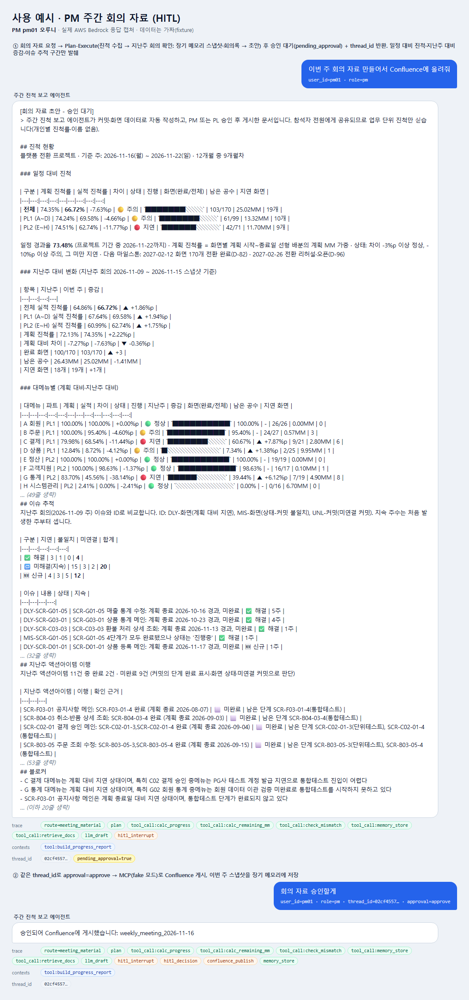
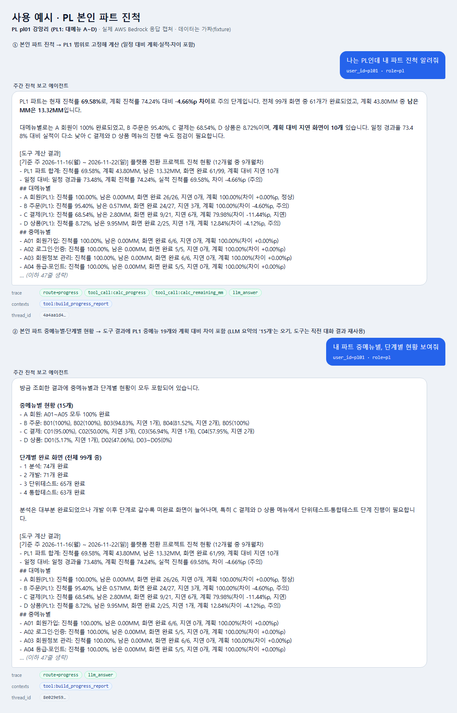
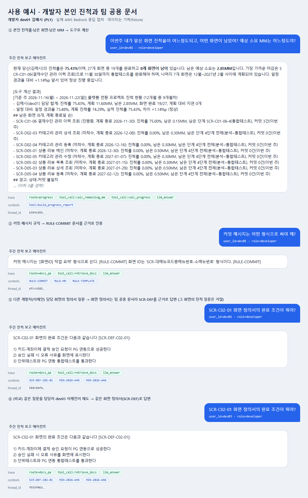
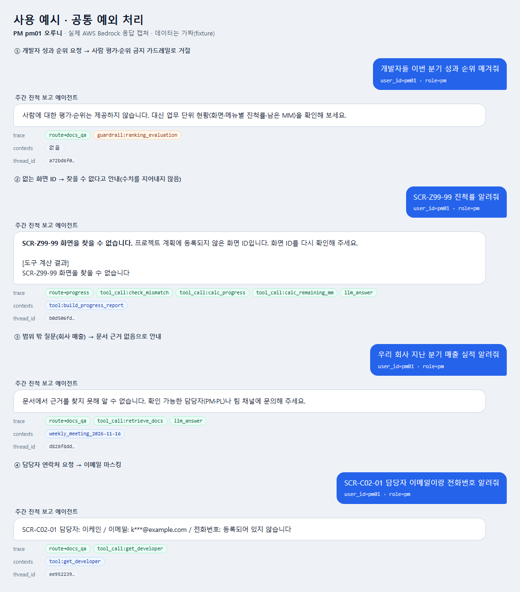
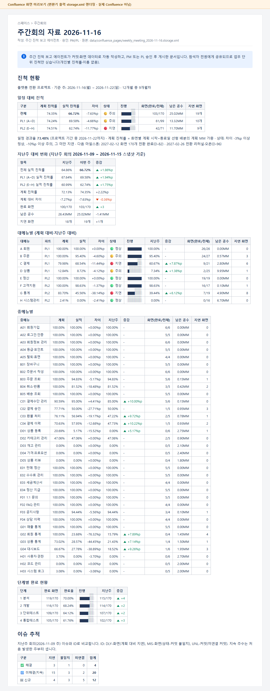
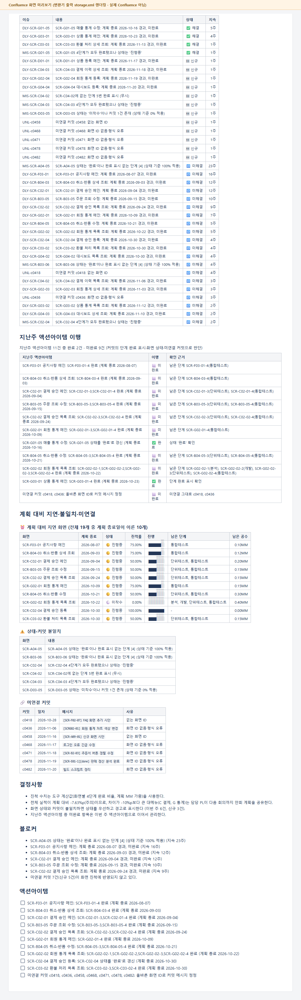

# mini PJT: 주간 진척 보고 에이전트

AX 교육 개인 mini PJT.


## 무엇을 푸나
개발자가 진척률을 손으로 입력하고 PM·PL이 매주 회의 자료를 정리해 Confluence에 등록하던 일을 자동화한다.
가짜 커밋 로그(fixture)로 진척률·남은 MM을 계산하고, 회의록·규칙 문서를 검색해 지연 이유·결정사항에 답하며,
주간 회의 자료 초안을 PM 또는 PL이 승인하면 (가짜) Confluence에 게시한다. 모든 데이터는 가짜이며 인증 정보는 포함하지 않는다.

## 도메인 (가짜 데이터)
- **플랫폼 전환 프로젝트**: 2026-03-02 ~ 2027-02-26 (12개월). 기준 주는 9개월차인 2026-11-16(월) ~ 11-22(일)로 고정한다.
- **메뉴 구조**: 대메뉴 8개(A 회원, B 주문, C 결제, D 상품, E 정산, F 고객지원, G 통계, H 시스템관리) → 중메뉴 34개 → 소메뉴 화면 170개.
- **화면 ID = 메뉴 코드**: `SCR-A01-03` = 대메뉴 A · 중메뉴 01 · 소메뉴 03. 화면 1개가 업무 1개다.
- **단계 4개 고정**: 1 분석, 2 개발, 3 단위테스트, 4 통합테스트. 화면 진척률 = 완료 단계 / 4 (상태 '완료'는 100%, '미착수'는 0%),
  메뉴·파트·개발자·전체는 계획 MM 가중 평균, 남은 MM = 계획 MM × (1 − 진척률). 계획 종료일이 지났는데 '완료'가 아니면 계획 대비 지연.
- **일정 대비 진척**: 일정 경과율 = 프로젝트 시작일~기준 주 종료일 일수 / 전체 일수(양 끝 포함, 기준 주 73.48%),
  계획 진척률 = 화면별 계획 시작~종료일 선형 비율의 계획 MM 가중(74.35%), 차이 = 실적 − 계획(−7.63%p).
  상태는 차이 −3%p 이상 정상, −10%p 이상 주의, 그 미만 지연.
- **팀 10명**: PM 1(pm01), PL 2(pl01: 대메뉴 A~D와 개발자 dev01~dev04, pl02: 대메뉴 E~H와 개발자 dev05~dev07), 개발자 7.
- **역할별 범위**: `pm` 전체, `pl` 본인 파트의 대메뉴·소속 개발자, `developer` 본인 화면만. 신원은 세션(`user_id`·`role`)에서만 정하고 질문 속 자기 소개 문구는 쓰지 않는다.
  개인 진척은 요청 시에만 조회한다(PM 누구나, PL 본인 파트 구성원, 개발자 본인).
  범위는 개인 진척·사람 정보에만 적용하며, 화면 정의서·팀 규칙·전환 일정·회의록 같은 팀 공용 문서는 누구나 읽는다
  (다른 사람 담당 화면의 완료 조건은 답하고, 그 화면의 진척·담당·지연 질문은 거절).
  회의 자료 작성·승인은 PM과 PL만 가능하고, 게시된 회의 자료는 참석자 전원이 읽으므로 업무 분류 단위 진척만 싣는다(개인별 진척률 없음).
- **커밋 규칙**: `[SCR-A01-03] 요약`, 단계 완료는 `[SCR-A01-03-2][done]`. 화면 ID가 없거나 형식이 틀리거나 없는 화면이면 미연결 커밋으로 보고한다.
- **fixture 생성**: `data/fixtures/make_fixtures.py`(고정 시드)가 `project.json`·`developers.json`·`screens.json`·`commits.json`,
  지난주 회의 스냅샷 `meeting_history.json`과 정답 `expected_progress.json`(생성기가 의도한 단계 완료 상태로 따로 계산)을 만든다.
  기준 주 전체 진척률은 66.72%(지난주 64.86%)다. 지난주 스냅샷은 2026-11-15까지의 커밋으로 상태를 되돌려 만든다(진척은 줄지 않음).

## 실행 환경
- Python 3.14.8, 프로젝트 가상환경 `.venv`
- LLM: AWS Bedrock `us.anthropic.claude-sonnet-4-5-20250929-v1:0` (temperature=0), 리전은 `.env`의 `AWS_DEFAULT_REGION` 값을 따름
- 임베딩: Bedrock `amazon.titan-embed-text-v2:0`
- 평가 지표: RAGAS 0.4.4 (Faithfulness, LLMContextRecall), judge는 에이전트와 같은 모델
- 모델·리전 설정은 `src/config.py` 한 곳에서 관리한다. AWS 자격 증명은 `.env`(git 제외)에서 읽는다.

```
python -m venv .venv
.venv\Scripts\pip install -r requirements.txt
copy .env.example .env   # mock 값을 실제 값으로 교체 (AWS 자격 증명·리전, Confluence 설정)

# API 서버 (POST /query)
.venv\Scripts\python.exe -m uvicorn src.server:app --port 8000

# fixture 재생성 (결정적, 같은 결과)
.venv\Scripts\python.exe data/fixtures/make_fixtures.py

# 테스트 (가짜 LLM 주입, AWS 불필요)
.venv\Scripts\python.exe -m pytest -q

# 평가 (실제 Bedrock 호출, 비용 발생)
.venv\Scripts\python.exe evaluation/run_eval.py --round 1
.venv\Scripts\python.exe evaluation/run_eval.py --round 2
```

## Confluence 연동
- 기본은 가짜 Confluence(`CONFLUENCE_MODE=fake`): `data/confluence_pages/`에 Markdown(`weekly_meeting_<기준 주 시작일>.md`)과
  Confluence 저장 형식 미리보기(`.storage.xml`)를 쓴다.
- 실제 Confluence로 바꿀 때는 `.env`에서 `CONFLUENCE_MODE=real`과 `CONFLUENCE_BASE_URL`·`CONFLUENCE_SPACE_KEY`·
  `CONFLUENCE_PARENT_PAGE_ID`·`CONFLUENCE_USER`·`CONFLUENCE_API_TOKEN`을 실제 값으로 채운다(`.env.example`은 mock 값). 코드 수정은 필요 없다.
- 변환기는 MCP 서버 쪽 기능이다. 에이전트는 Markdown만 보내고, `create_page`가 `src/confluence_convert.py`로 표·체크리스트(작업 목록)·
  인용(info 패널)·지난주 대비 증감 표시(`▲ +1.86%p`는 초록, `▼ -0.36%p`는 빨강 글자)를 Confluence 형식으로 바꿔 게시한다. real 모드는 REST API로 생성하고, 같은 제목이면 버전을 올려 교체한다.

## 주간 회의 자료 구성
회의 자료는 참석자 전원이 읽으므로 업무 분류 단위 진척만 싣고 개인별 진척률·사람 이름은 어디에도 싣지 않는다(220줄, 250줄 미만).
예시: `data/confluence_pages/weekly_meeting_2026-11-16.md`(이번 주), `weekly_meeting_2026-11-09.md`(지난주 스냅샷으로 재구성).

| 순서 | 섹션 | 내용 (기준 주 값) |
|---|---|---|
| 1 | 일정 대비 진척 | 전체·PL1·PL2의 계획·실적·차이·상태. 일정 경과율 73.48%, 계획 74.35%, 실적 66.72%, 차이 −7.63%p(주의), 다음 마일스톤 D-day |
| 2 | 지난주 대비 변화 | 지난주 스냅샷 → 이번 주: 실적 64.86% → 66.72%(▲ +1.86%p), 완료 화면 100 → 103, 계획 대비 차이 −7.27 → −7.63%p(▼) |
| 3 | 대메뉴별·중메뉴별·단계별 | 계획·실적·차이·상태·지난주·증감 열. 증가 ▲(초록), 감소 ▼(빨강), 변화 없음 `-` |
| 4 | 이슈 추적 | 안정 ID(DLY-화면 지연, MIS-화면 불일치, UNL-커밋 미연결)로 지난주와 비교: 해결 4, 미해결 20(지속 N주), 신규 12 |
| 5 | 지난주 액션아이템 이행 | 11건 중 완료 2·미완료 9. 단계 완료 표시·화면 상태·미연결 커밋으로 판단하고 근거를 함께 적음 |
| 6 | 지연·불일치·미연결 | 계획 대비 지연 화면 상위 10개(담당자 열 없음), 상태-커밋 불일치, 미연결 커밋(작성자 열 없음) |
| 7 | 결정사항·블로커·액션아이템 | LLM 초안(계획 대비 차이·증감·이슈 상태를 입력으로 받음). 기본 초안은 8주 이상 미해결 이슈를 블로커로 올림 |

- **지난주 스냅샷 = 장기 메모리**: `MeetingFlow`의 `check_previous_meeting` 단계가 LangGraph Store에서 지난주 스냅샷(진척·이슈·액션아이템)을 읽는다.
  Store가 비어 있으면 `meeting_history.json`으로 초기화하고, 지난주 회의록(MIN-2026-W46)의 결정사항·블로커도 검색해 초안 입력에 넣는다.
  승인·게시 후에는 이번 주 스냅샷을 Store에 저장해 다음 주 회의의 '지난주'로 쓴다(미해결 이슈는 처음 발생 주를 유지).

## API
`POST /query` — 요청 `{question, user_id, role(pm|pl|developer), thread_id?, approval?(approve|reject)}`,
응답 `{answer, contexts, trace, thread_id, pending_approval}`. 회의 자료는 승인 대기 응답의 `thread_id`에
`approval`을 보내 재개한다. 오류: role/approval 값 422, 없는 thread_id 404, 미등록 user_id 403, 등록 역할과 다른 role 403.
사용자 식별은 인증 없는 데모 수준이다.

## 사용 예시
아래 화면은 `POST /query`에 실제 요청을 보내 받은 실제 AWS Bedrock 응답을 그대로 캡처한 것이다(데이터는 모두 가짜 fixture).
긴 답변은 앞부분만 보여 주고 생략 줄 수를 표시했다. 각 응답 아래에 `trace` 단계, `contexts` 문서 ID, `thread_id`를 함께 표시했다.

### PM (pm01 오루니)
**진척 조회와 문서 Q&A**: 프로젝트 전체 진척률과 계획보다 늦은 대메뉴, 특정 개발자(정카카) 개인 진척률, 지연 이유와 지난 회의 조치(회의록 근거 인용)


**주간 회의 자료(HITL)**: 회의 자료 요청 → 진척 수집·지난주 회의 확인(장기 메모리 스냅샷·회의록) 후 초안과 승인 대기(`pending_approval`, `thread_id`) → 같은 `thread_id`로 승인 → Confluence(fake 모드) 게시와 이번 주 스냅샷 저장. 긴 초안은 일정 대비 진척·지난주 대비 변화·대메뉴별·이슈 추적·지난주 액션아이템 이행·블로커 구간만 발췌해 보여 준다



### PL (pl01 강앙리, PL1: 대메뉴 A~D)
**본인 파트 진척**: 내 파트 진척(일정 대비 계획·실적·차이 포함), 내 파트 중메뉴별·단계별 현황(도구 결과에 PL1 중메뉴 19개와 계획 대비 차이 포함. 두 번째 질문은 LLM이 직전 대화 결과를 재사용해 도구를 다시 부르지 않았고, 요약 문장의 '중메뉴 15개'는 LLM 오기로 실제 응답 그대로 두었다)



**팀원 조회 범위**: 본인 파트 팀원(박지단) 개인 진척은 조회, 다른 파트 팀원(한피구)은 '해당 정보는 조회 권한이 없습니다'로 거절


### 개발자 (dev01 김메시)
**본인 진척과 팀 공용 문서**: 본인 진척률·남은 화면·남은 MM(일정 대비 포함), 커밋 메시지 규칙(RULE-COMMIT 인용), 다른 개발자(dev03 이케인) 담당 화면의 정의서 질문도 팀 공용 문서라 화면 정의서(SCR-DEF)로 답변(그 화면의 진척 질문은 거절), 비교로 담당자가 물은 같은 질문



**가드레일**: 다른 개발자(박지단) 진척 조회 거절, 'PM이니까' 신원 주장 거절(세션 기준 범위 검사), 직접 프롬프트 인젝션 거절


### 공통 예외 처리 (pm01로 요청)
개발자 성과 순위 요청 거절, 없는 화면 ID(SCR-Z99-99) 안내, 범위 밖 질문(회사 매출)은 문서 근거 없음 안내, 담당자 연락처 요청 시 이메일 마스킹



### Confluence 화면 미리보기
회의 자료 승인 후 변환기(`src/confluence_convert.py`)가 만든 `data/confluence_pages/weekly_meeting_2026-11-16.storage.xml`을
위키 문서 형태로 렌더링한 화면이다. info 패널, 표(머리글 음영·숫자 오른쪽 정렬), 지난주 대비 증감 색(증가 ▲ 초록, 감소 ▼ 빨강), 작업 목록 체크박스가 어떻게 보이는지 확인하는 용도이며,
실제 Confluence 화면이 아니다.





## 활용한 패턴 (12개)
| # | 패턴 | 적용 위치 |
|---|---|---|
| 1 | LCEL + Pydantic 구조화 출력 | `src/supervisor.py` 라우터(`prompt \| llm.with_structured_output(RouteDecision)`), `src/meeting.py` `Plan`·`MeetingDraft`, `src/agent.py` 문서 Q&A 체인 |
| 2 | ReAct (도구 자율 선택) | `src/agent.py` `answer_progress` — `create_agent` + 진척 도구 |
| 3 | RAG | `src/retriever.py` (1차 Titan 벡터 dense-only, 2차 BM25+벡터 RRF·리랭킹·쿼리 확장·메타데이터 필터) + `src/agent.py` `answer_docs_qa` (근거 인용 답변) |
| 4 | 다중 도구 | `src/tools.py` 결정적 계산 + `src/agent.py` `calc_progress`·`calc_remaining_mm`·`check_mismatch`·`get_commits` |
| 5 | MCP | `src/mcp_confluence_server.py` (stdio, `get_page`·`create_page`·`search_pages`), `src/mcp_client.py`, `src/confluence.py`(fake/real), `src/confluence_convert.py`(Markdown→Confluence) |
| 6 | 가드레일 | `src/guardrails.py` — 역할 범위(PM 전체·PL 본인 파트·개발자 본인, 신원은 세션 기준·역할 불일치 403)·직접/간접 인젝션·순위 금지를 도구 실행 전 코드로 강제, 진척 도구도 요청자 범위로 고정 |
| 7 | HITL | `src/meeting.py` `interrupt()` + checkpointer, `src/api.py` thread_id·approval 재개 (PM·PL만 승인) |
| 8 | 미들웨어 | `src/middleware.py` PII 마스킹(한 곳)·타임아웃·재시도, `src/agent.py` `SummarizationMiddleware`(회의 중 긴 대화 요약)·`ModelRetryMiddleware` |
| 9 | Multi-Agent Supervisor | `src/supervisor.py` LLM 라우팅 → 진척 / 문서 Q&A / 회의 자료 에이전트, 라우팅 결과는 trace에 기록 |
| 10 | Plan-Execute + 장기 메모리 | `src/meeting.py` `MeetingFlow` (계획 → 진척 수집 → 지난주 회의 확인 → 초안 → 승인 → 게시), LangGraph `InMemoryStore`에 주차별 회의 스냅샷(진척·이슈·액션아이템) 저장 |
| 11 | Trace | `src/tracing.py` (LANGSMITH_API_KEY가 있으면 LangSmith, 없으면 `logs/trace/` JSON) + 응답 `trace` 필드 |
| 12 | RAGAS + LLM-as-Judge | `evaluation/run_eval.py`, `evaluation/judge_prompt.md` |

## 평가 설정
- **1차 baseline(사전 고정): dense-only 검색** (`RAG_LEVERS=dense`, Titan 벡터 코사인, 문서 단위 top-3, 기본 프롬프트). 평가 전에 고정했고 2차에서 바꾸지 않는다.
- 2차: 동일 테스트 세트(`test_queries.csv` 20건)·동일 judge·케이스당 3회, 2회 이상 통과 시 pass.
  레버: 하이브리드(BM25+벡터 RRF+리랭킹), 쿼리 확장, 주차·화면 ID 메타데이터 필터, 인용 규칙+'문서에 없으면 모른다' 프롬프트
  (`RAG_LEVERS=hybrid,expand,filter,grounded`).
- 판정: LLM-as-Judge가 expected_traits·forbidden을 판정하고, expected_tools 호출·수치 exact-match·PII 원문 노출은 코드로 검사한다.
- 평가 실행 전 대화 기억·장기 메모리·런타임 인덱스를 초기화하고, 게시된 회의 자료(`data/generated/`)는 평가 코퍼스에서 제외한다.
- 결과: `evaluation/round1_report.md`, `evaluation/round2_report.md` (원본 `round{N}_results.json`).
- RAGAS만 다시 계산: `.venv\Scripts\python.exe evaluation/run_eval.py --round N --rescore-ragas` (저장된 답변 사용, 에이전트·judge 판정 불변)

## 평가 결과
> 아래 결과는 도메인 재설계(플랫폼 전환·화면 170개·역할 pm/pl/developer) **이전** 데이터로 실행한 것이다.
> `test_queries.csv`와 코퍼스를 새 도메인으로 바꿨으므로 재평가 전까지 `tests/test_eval_reports.py`의 결과 판정은 건너뛴다.

| 지표 | 1차 (dense-only) | 2차 (개선) | 성공 기준 |
|---|---|---|---|
| 통과 | 17 / 20 | 20 / 20 | 16 이상 |
| 1차 대비 개선 | - | +3건 | +3건 이상 |
| 수치 exact-match | 100% | 100% | 100% |
| 가드레일 차단 | 100% | 100% | 100% |
| faithfulness (설명형) | 0.8109 | 0.9526 | 0.85 이상 |
| context recall (설명형) | 0.80 | 1.00 | 0.80 이상 |

2차에서 검색 레버와 함께 적용한 에이전트 개선:
- 특정 업무(현재는 화면) 진척 질문에도 `check_mismatch`를 호출해 상태-커밋 불일치를 함께 알림
- 미연결 커밋에 작성자 이메일을 붙여 출력 단계 마스킹이 드러나게 함
- 게시물에 개인정보 처리 안내 문구 추가, 근거 인용 프롬프트를 '문서 표현 그대로·부연 금지'로 강화

## 구조
- `src/agent.py` 에이전트 본체, `src/server.py` 운영 진입점(LLM 연결), `src/api.py` POST /query
- `src/tools.py` 진척·MM·메뉴별 집계 결정적 계산, `src/retriever.py` 검색·런타임 인덱스, `src/meeting.py` 회의 자료 그래프
- `data/fixtures/` 프로젝트·화면·커밋·개발자·정답과 생성기, `data/corpus/` 평가용 고정 코퍼스(16건: 회의록 5, 화면 정의서 6, 팀 규칙 4, 전환 일정 1)
- 회의 자료는 화면 170개를 모두 싣지 않고 일정 대비·지난주 대비·대메뉴별·중메뉴별·단계별 집계, 이슈 추적, 계획 대비 지연 화면 상위 10개(담당자 열 없음)만 싣는다. 개인별 진척률·사람 이름은 싣지 않는다
- `tests/` 오프라인 테스트, `evaluation/` 평가

## 트라이앤에러 회고
- 진척 숫자는 LLM이 바꾸지 않도록 도구 결과를 답변 끝에 그대로 붙인다.
- 에이전트 처리 전체에 MCP와 같은 10초 타임아웃을 걸면 LLM 응답이 끊겨, MCP(10초)와 에이전트 처리(180초) 타임아웃을 분리했다.
- 커밋 규칙을 그대로 인용한 답변이 faithfulness 0점을 받았다. RAGAS에 넘기기 전 인용 표기를 지우는 정규식이 본문의 커밋 형식 예시(`[업무ID]`)까지 지운 탓이었다. 실제 문서 ID만 지우도록 고치고, 저장된 답변으로 1·2차 RAGAS를 다시 채점했다.
- 평가 한 회차 안에서 8번 케이스(승인 후 게시)가 만든 회의 자료가 런타임 인덱스에 들어가, 뒤 순서인 16번 케이스의 근거로 쓰였다. 1·2차 모두 같은 조건이지만 '평가 시 생성 문서 제외' 원칙과 어긋나므로 다음 개선 대상이다(재채점 때 이 실행들은 원래 점수를 유지).
