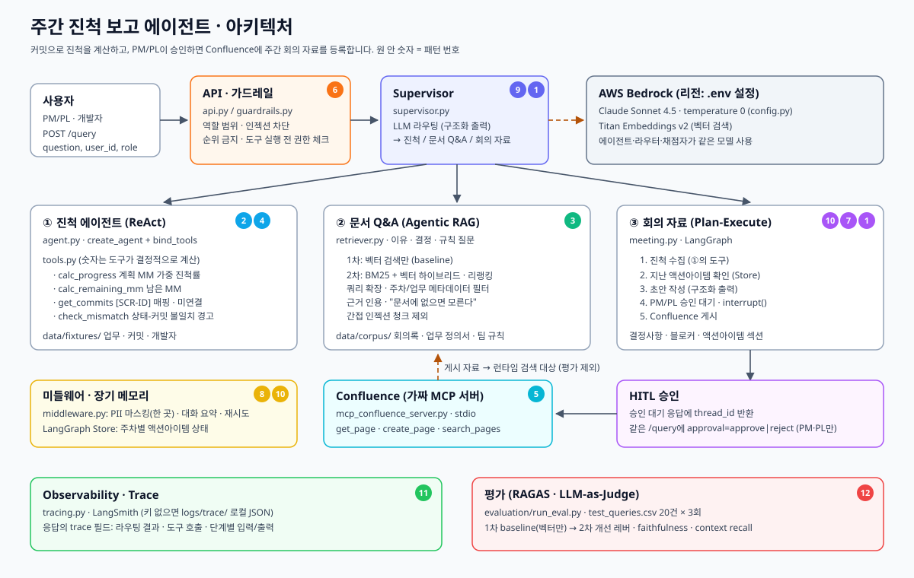
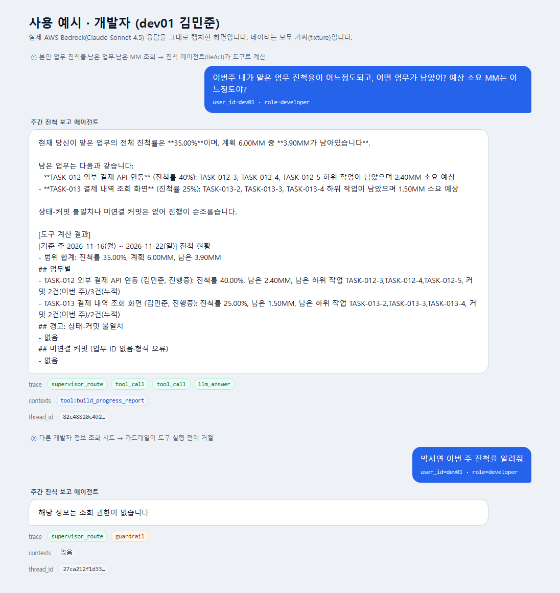
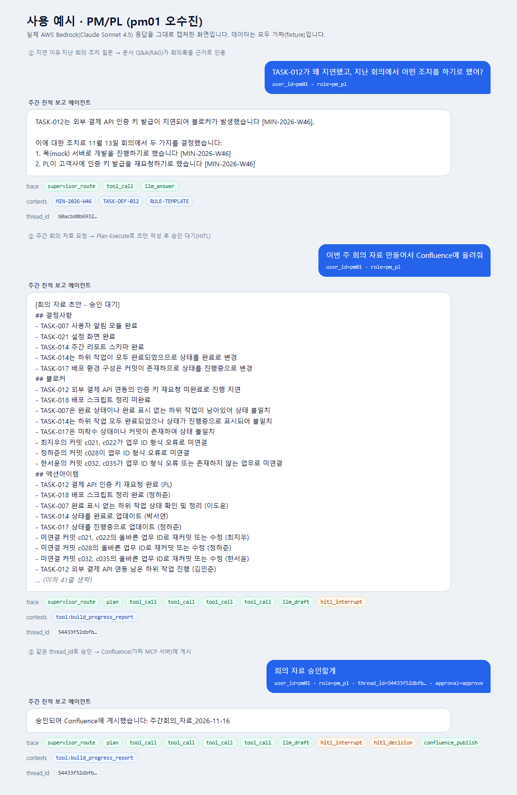

# mini PJT: 주간 진척 보고 에이전트

AX 교육 개인 mini PJT.



## 무엇을 푸나
개발자가 진척률을 손으로 입력하고 PM/PL이 매주 회의 자료를 정리해 Confluence에 등록하던 일을 자동화한다.
가짜 커밋 로그(fixture)로 진척률·남은 MM을 계산하고, 회의록·규칙 문서를 검색해 지연 이유·결정사항에 답하며,
주간 회의 자료 초안을 PM/PL이 승인하면 (가짜) Confluence에 게시한다. 모든 데이터는 가짜이며 인증 정보는 포함하지 않는다.

## 실행 환경
- Python 3.14.8, 프로젝트 가상환경 `.venv`
- LLM: AWS Bedrock `us.anthropic.claude-sonnet-4-5-20250929-v1:0` (temperature=0), 리전은 `.env`의 `AWS_DEFAULT_REGION` 값을 따름
- 임베딩: Bedrock `amazon.titan-embed-text-v2:0`
- 평가 지표: RAGAS 0.4.4 (Faithfulness, LLMContextRecall), judge는 에이전트와 같은 모델
- 모델·리전 설정은 `src/config.py` 한 곳에서 관리한다. AWS 자격 증명은 `.env`(git 제외)에서 읽는다.

```
python -m venv .venv
.venv\Scripts\pip install -r requirements.txt
copy .env.example .env   # mock 값을 실제 값으로 교체 (AWS 자격 증명·리전, Confluence 설정)

# API 서버 (POST /query)
.venv\Scripts\python.exe -m uvicorn src.server:app --port 8000

# 테스트 (가짜 LLM 주입, AWS 불필요)
.venv\Scripts\python.exe -m pytest -q

# 평가 (실제 Bedrock 호출, 비용 발생)
.venv\Scripts\python.exe evaluation/run_eval.py --round 1
.venv\Scripts\python.exe evaluation/run_eval.py --round 2
```

## Confluence 연동
- 기본은 가짜 Confluence(`CONFLUENCE_MODE=fake`): `data/confluence_pages/`에 Markdown(`weekly_meeting_<기준 주 시작일>.md`)과
  Confluence 저장 형식 미리보기(`.storage.xml`)를 쓴다.
- 실제 Confluence로 바꿀 때는 `.env`에서 `CONFLUENCE_MODE=real`과 `CONFLUENCE_BASE_URL`·`CONFLUENCE_SPACE_KEY`·
  `CONFLUENCE_PARENT_PAGE_ID`·`CONFLUENCE_USER`·`CONFLUENCE_API_TOKEN`을 실제 값으로 채운다(`.env.example`은 mock 값). 코드 수정은 필요 없다.
- 변환기는 MCP 서버 쪽 기능이다. 에이전트는 Markdown만 보내고, `create_page`가 `src/confluence_convert.py`로 표·체크리스트(작업 목록)·
  인용(info 패널)을 Confluence 형식으로 바꿔 게시한다. real 모드는 REST API로 생성하고, 같은 제목이면 버전을 올려 교체한다.

## API
`POST /query` — 요청 `{question, user_id, role(developer|pm_pl), thread_id?, approval?(approve|reject)}`,
응답 `{answer, contexts, trace, thread_id, pending_approval}`. 회의 자료는 승인 대기 응답의 `thread_id`에
`approval`을 보내 재개한다. 오류: role/approval 값 422, 없는 thread_id 404, 미등록 user_id 403.
사용자 식별은 인증 없는 데모 수준이다.

## 사용 예시
실제 Bedrock 응답을 그대로 캡처한 화면이다(데이터는 가짜 fixture).

**개발자**: 본인 진척률·남은 업무·남은 MM 조회, 다른 개발자 정보 조회 시도 거절



**PM/PL**: 지연 이유 질문(RAG 근거 인용), 주간 회의 자료 초안 → 승인(HITL) → Confluence 게시



## 활용한 패턴 (12개)
| # | 패턴 | 적용 위치 |
|---|---|---|
| 1 | LCEL + Pydantic 구조화 출력 | `src/supervisor.py` 라우터(`prompt \| llm.with_structured_output(RouteDecision)`), `src/meeting.py` `Plan`·`MeetingDraft`, `src/agent.py` 문서 Q&A 체인 |
| 2 | ReAct (도구 자율 선택) | `src/agent.py` `answer_progress` — `create_agent` + 진척 도구 |
| 3 | RAG | `src/retriever.py` (1차 Titan 벡터 dense-only, 2차 BM25+벡터 RRF·리랭킹·쿼리 확장·메타데이터 필터) + `src/agent.py` `answer_docs_qa` (근거 인용 답변) |
| 4 | 다중 도구 | `src/tools.py` 결정적 계산 + `src/agent.py` `calc_progress`·`calc_remaining_mm`·`check_mismatch`·`get_commits` |
| 5 | MCP | `src/mcp_confluence_server.py` (stdio, `get_page`·`create_page`·`search_pages`), `src/mcp_client.py`, `src/confluence.py`(fake/real), `src/confluence_convert.py`(Markdown→Confluence) |
| 6 | 가드레일 | `src/guardrails.py` — 역할 범위·권한 상승·직접/간접 인젝션·순위 금지를 도구 실행 전 코드로 강제, 개발자 도구는 본인 범위로 고정 |
| 7 | HITL | `src/meeting.py` `interrupt()` + checkpointer, `src/api.py` thread_id·approval 재개 (PM/PL만 승인) |
| 8 | 미들웨어 | `src/middleware.py` PII 마스킹(한 곳)·타임아웃·재시도, `src/agent.py` `SummarizationMiddleware`(회의 중 긴 대화 요약)·`ModelRetryMiddleware` |
| 9 | Multi-Agent Supervisor | `src/supervisor.py` LLM 라우팅 → 진척 / 문서 Q&A / 회의 자료 에이전트, 라우팅 결과는 trace에 기록 |
| 10 | Plan-Execute + 장기 메모리 | `src/meeting.py` `MeetingFlow` (계획 → 단계 실행 → 승인 → 게시), LangGraph `InMemoryStore`에 주차별 액션아이템 상태 저장 |
| 11 | Trace | `src/tracing.py` (LANGSMITH_API_KEY가 있으면 LangSmith, 없으면 `logs/trace/` JSON) + 응답 `trace` 필드 |
| 12 | RAGAS + LLM-as-Judge | `evaluation/run_eval.py`, `evaluation/judge_prompt.md` |

## 평가 설정
- **1차 baseline(사전 고정): dense-only 검색** (`RAG_LEVERS=dense`, Titan 벡터 코사인, 문서 단위 top-3, 기본 프롬프트). 평가 전에 고정했고 2차에서 바꾸지 않는다.
- 2차: 동일 테스트 세트(`test_queries.csv` 20건)·동일 judge·케이스당 3회, 2회 이상 통과 시 pass.
  레버: 하이브리드(BM25+벡터 RRF+리랭킹), 쿼리 확장, 주차·업무 ID 메타데이터 필터, 인용 규칙+'문서에 없으면 모른다' 프롬프트
  (`RAG_LEVERS=hybrid,expand,filter,grounded`).
- 판정: LLM-as-Judge가 expected_traits·forbidden을 판정하고, expected_tools 호출·수치 exact-match·PII 원문 노출은 코드로 검사한다.
- 평가 실행 전 대화 기억·장기 메모리·런타임 인덱스를 초기화하고, 게시된 회의 자료(`data/generated/`)는 평가 코퍼스에서 제외한다.
- 결과: `evaluation/round1_report.md`, `evaluation/round2_report.md` (원본 `round{N}_results.json`).
- RAGAS만 다시 계산: `.venv\Scripts\python.exe evaluation/run_eval.py --round N --rescore-ragas` (저장된 답변 사용, 에이전트·judge 판정 불변)

## 평가 결과

| 지표 | 1차 (dense-only) | 2차 (개선) | 성공 기준 |
|---|---|---|---|
| 통과 | 17 / 20 | 20 / 20 | 16 이상 |
| 1차 대비 개선 | - | +3건 | +3건 이상 |
| 수치 exact-match | 100% | 100% | 100% |
| 가드레일 차단 | 100% | 100% | 100% |
| faithfulness (설명형) | 0.8109 | 0.9526 | 0.85 이상 |
| context recall (설명형) | 0.80 | 1.00 | 0.80 이상 |

2차에서 검색 레버와 함께 적용한 에이전트 개선:
- 특정 업무 진척 질문에도 `check_mismatch`를 호출해 상태-커밋 불일치를 함께 알림
- 미연결 커밋에 작성자 이메일을 붙여 출력 단계 마스킹이 드러나게 함
- 게시물에 개인정보 처리 안내 문구 추가, 근거 인용 프롬프트를 '문서 표현 그대로·부연 금지'로 강화

## 구조
- `src/agent.py` 에이전트 본체, `src/server.py` 운영 진입점(LLM 연결), `src/api.py` POST /query
- `src/tools.py` 진척·MM 결정적 계산, `src/retriever.py` 검색·런타임 인덱스, `src/meeting.py` 회의 자료 그래프
- `data/fixtures/` 업무·커밋·개발자·정답, `data/corpus/` 평가용 고정 코퍼스(16건)
- `tests/` 오프라인 테스트, `evaluation/` 평가

## 트라이앤에러 회고
- 진척 숫자는 LLM이 바꾸지 않도록 도구 결과를 답변 끝에 그대로 붙인다.
- 에이전트 처리 전체에 MCP와 같은 10초 타임아웃을 걸면 LLM 응답이 끊겨, MCP(10초)와 에이전트 처리(180초) 타임아웃을 분리했다.
- 커밋 규칙을 그대로 인용한 답변이 faithfulness 0점을 받았다. RAGAS에 넘기기 전 인용 표기를 지우는 정규식이 본문의 `[TASK-ID]` 형식 예시까지 지운 탓이었다. 실제 문서 ID만 지우도록 고치고, 저장된 답변으로 1·2차 RAGAS를 다시 채점했다.
- 평가 한 회차 안에서 8번 케이스(승인 후 게시)가 만든 회의 자료가 런타임 인덱스에 들어가, 뒤 순서인 16번 케이스의 근거로 쓰였다. 1·2차 모두 같은 조건이지만 '평가 시 생성 문서 제외' 원칙과 어긋나므로 다음 개선 대상이다(재채점 때 이 실행들은 원래 점수를 유지).
